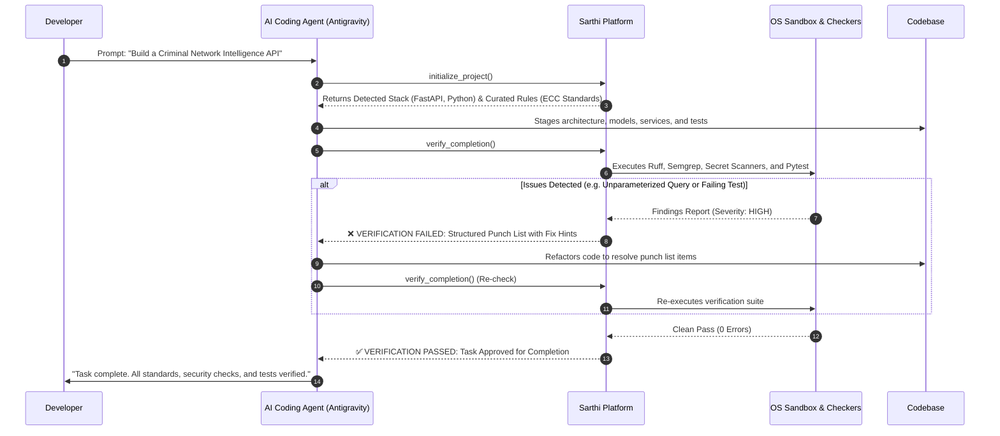

# Sarthi — Features & Capabilities Guide

> **Production engineering standards, security guardrails, and automated verification for AI coding agents.**

---

## 1. Executive Summary & Purpose

When developers use modern AI coding assistants (such as Google Antigravity, Claude Code, or Cursor), the AI can generate hundreds of lines of code in seconds. However, AI models inherently prioritize speed and brevity over engineering rigor. Without intervention, AI models frequently:
- Dump hundreds of lines into a single monolithic file rather than maintaining clean architectural separation.
- Leave plain-text credentials, unparameterized database queries, and unmasked PII in the code.
- Write superficial tests (like `assert True`) or skip testing altogether.
- Run terminal commands that possess the full permissions of the developer's operating system user account.
- Declare tasks **"Completed"** when the code doesn't compile, breaks edge cases, or violates security policies.

### The Purpose of Sarthi
**Sarthi is the automated Senior Technical Lead and Quality Inspector for AI coding agents.**

It installs locally into your IDE and sits between your AI assistant and your codebase. It detects your stack, injects industry-grade coding standards into the AI's context, confines execution inside an OS-level security sandbox, and physically blocks the AI from finishing a task until the code passes deterministic linters, security AST scanners, and automated test suites.

```
       ┌────────────────────────────────────────────────────────┐
       │                Your AI Coding Assistant                │
       │             (Google Antigravity / Cursor)              │
       └───────────────────────────┬────────────────────────────┘
                                   │
                         [MCP Protocol / Stdio]
                                   │
                                   ▼
       ┌────────────────────────────────────────────────────────┐
       │                    SARTHI PLATFORM                     │
       │  ┌──────────────────┐  ┌─────────────────────────────┐ │
       │  │ Stack Detector   │  │ Curated Standards (ECC)     │ │
       │  └──────────────────┘  └─────────────────────────────┘ │
       │  ┌──────────────────┐  ┌─────────────────────────────┐ │
       │  │ PathGuard & Trust│  │ OS Sandbox & Staging        │ │
       │  └──────────────────┘  └─────────────────────────────┘ │
       │  ┌──────────────────┐  ┌─────────────────────────────┐ │
       │  │ Sterile Git      │  │ Verification Completion Gate│ │
       │  └──────────────────┘  └─────────────────────────────┘ │
       └───────────────────────────┬────────────────────────────┘
                                   │
                   [Automated Quality Verification]
                                   │
                                   ▼
       ┌────────────────────────────────────────────────────────┐
       │                Production-Grade Codebase               │
       │   • Clean Folder Structure   • 100% Parameterized DB   │
       │   • Passing Unit Tests       • Conventional Commits    │
       │   • Zero Leaked Secrets      • Documented Public APIs  │
       └────────────────────────────────────────────────────────┘
```

---

## 2. Core Features in Detail

### Feature 1: Seamless One-Command IDE Integration
- **Universal MCP Protocol:** Built as a native [Model Context Protocol (MCP)](https://modelcontextprotocol.io/) server communicating over standard I/O (`stdio`).
- **One-Command Setup:** Run `sarthi install antigravity` to instantly configure the server and inject the **Sarthi Core Contract** into the IDE's prompt instructions (`GEMINI.md`).
- **Clean Uninstallation:** Run `sarthi uninstall antigravity` to cleanly remove the MCP server and restore all IDE configuration files byte-for-byte from backups.

### Feature 2: Automatic Stack & Layer Detection
- **Multi-Language Detection:** Automatically identifies project languages (Python, TypeScript, JavaScript, Java, Go, Rust) and frameworks (FastAPI, Django, Flask, Express, React, Vite, Next.js).
- **Environment & Tooling Discovery:** Recognizes test runners (`pytest`, `jest`, `npm test`, `mvn`, `gradle`), package managers (`uv`, `poetry`, `npm`, `pnpm`), and databases (`PostgreSQL`, `SQLite`, `MySQL`, `Neo4j`).
- **Context-Budget Efficiency:** Instead of overwhelming the AI with thousands of irrelevant global rules, Sarthi filters and delivers only the exact rules relevant to the detected stack.

### Feature 3: Curated Enterprise Standards Library (ECC Snapshot)
- **Deep Rule Catalog:** Comes pre-loaded with curated, battle-tested software engineering standards categorized into 6 core pillars:
  1. **Architecture:** Layered separation (routers $\rightarrow$ services $\rightarrow$ repositories), single responsibility, dependency inversion.
  2. **Security:** Injection prevention (SQL/Cypher/Command), authentication/authorization, PII masking, cryptographic hygiene.
  3. **Testing:** Unit test isolation, mandatory edge-case coverage, integration testing guidelines.
  4. **API Design:** RESTful conventions, Pydantic/DTO schema validation, error response schemas (RFC 7807).
  5. **Data Management:** Safe migration practices, transaction boundaries, connection pooling.
  6. **Performance:** Efficient querying, async non-blocking I/O, pagination enforcement.

### Feature 4: The Uncompromising "Completion Gate" (Verifier Pipeline)
The AI cannot simply claim a task is complete. When the AI attempts to finish, Sarthi triggers its multi-engine verification pipeline:
- **Ruff Runner:** High-speed static linting, typing validation, and formatting for Python code.
- **ESLint Runner:** AST-based code health checks for JavaScript and TypeScript codebases.
- **Semgrep Runner:** Deep semantic vulnerability scanning (flags SQL injection, SSRF, path traversals, insecure deserialization).
- **Secrets Runner:** Comprehensive regex and entropy scanning to block accidental leaks of API tokens, private keys, and `.env` values.
- **Test Runner:** Discovers and executes actual project test suites (`pytest`, `npm test`), ensuring the code works functionally.

### Feature 5: PathGuard & Command Trust Security Fence
- **PathGuard (`SEC-01A`):** Pure-Python lexical path normalization and boundary enforcement that prevents the AI from reading or writing outside the project root directory.
- **CommandTrustManager (`SEC-01B`):** 
  - Prevents the AI from executing unapproved terminal commands.
  - Automatically neutralizes dangerous shell chaining and metacharacters (`&&`, `|`, `;`, `` ` ``, `$()`).
  - Implements SHA-256 persistent hashing so developers review and approve command templates once.
- **Environment Sanitization:** Strips LLM API keys (`OPENAI_API_KEY`, `ANTHROPIC_API_KEY`, `GEMINI_API_KEY`), cloud tokens, and sensitive system variables before any subprocess is spawned.

### Feature 6: OS-Level Sandbox & Workspace Staging (`SEC-01C`)
Protects the developer's laptop from malicious or buggy generated code during test runs:
- **Workspace Staging Pipeline:** Automatically duplicates the project repository into a fresh directory tree before test execution:
  - Copies regular files by value, allocating fresh OS inodes to sever external hardlink sharing.
  - Recursively validates relative symlinks, strictly forbidding symlinks that escape the project boundary.
  - Rejects special file types (FIFOs, named pipes, UNIX domain sockets, character/block device nodes) fail-closed.
  - Automatically purges staging directories upon completion or failure.
- **Kernel-Enforced Isolation Backends:**
  - **Windows Backend:** Leverages Windows **AppContainer SIDs** (default-deny filesystem access and WFP network blocking) combined with **Job Objects** for hard memory caps and process-tree termination.
  - **Linux Backend:** Leverages **Bubblewrap (`bwrap`)** minimal runtime mount namespaces (`/usr`, `/lib`, `/bin` read-only; virtual `/proc`; `/tmp` tmpfs), `--unshare-net` network isolation, and capability dropping.
  - **macOS Backend:** Reports honest vendor deprecation for `sandbox-exec` and refuses unconfined execution by default.

### Feature 7: Tier 1 Sterile Git Execution
Internal VCS queries are hardened against hook hijacking and malicious repository configurations:
- **Strict Allowlist:** Only 4 deterministic, read-only metadata queries are permitted (`rev-parse --is-inside-work-tree`, `rev-parse HEAD`, `status --porcelain`, `diff --name-only`).
- **Sterile Environment Injections:**
  - Forces `GIT_CONFIG_NOSYSTEM=1`, `GIT_CONFIG_SYSTEM=/dev/null`, and `GIT_CONFIG_GLOBAL=/dev/null`.
  - Sets an isolated temporary `HOME` directory.
  - Strips all `GIT_*` environment variables and network proxies.
  - Passes rigid command-line overrides (`-c core.hooksPath=""`, `-c core.fsmonitor=false`, `-c diff.external=`, `-c credential.helper=`, `-c protocol.allow=never`, `-c core.sshCommand=/bin/false`, `--no-pager`, `--no-ext-diff`, `--no-textconv`).
- **Tier 2 Confinement:** Any Git operation that mutates working tree files or checkouts is required to execute inside the OS sandbox.

### Feature 8: Disciplined Engineering Standards Enforcement
Sarthi ensures that the AI writes code like a senior software engineer:
- **Folder Structure Enforcement:** Enforces clean modular directory hierarchies (e.g. separating API routers, business logic services, data models, and database repositories).
- **Docstring & Comment Quality:** Mandates docstrings on public classes, functions, and API routes; requires inline comments documenting *why* complex algorithms are chosen.
- **Conventional Git Commits:** Instructs the AI to make small, atomic, and structured commits (`feat(...)`, `fix(...)`, `test(...)`, `docs(...)`) throughout development.
- **Documentation Maintenance:** Enforces that `README.md`, setup guides, and environment variable specs (`.env.example`) are created and updated regularly.

### Feature 9: The Self-Healing Remediation Loop
- **Actionable Punch Lists:** When verification fails, Sarthi does not emit cryptic stack traces. It returns a structured finding list containing:
  - Exact rule violation identifier (`UNI-TEST-001`, `SEC-INJ-001`).
  - Severity level (`CRITICAL`, `HIGH`, `MEDIUM`, `LOW`).
  - Target file path and line number.
  - Clear explanation of the flaw.
  - Actionable **Fix Hint** showing how to remediate the code.
- **Iterative Repair:** The AI agent reads the punch list, edits the code to fix the issues, and re-invokes verification until Sarthi awards an unambiguous `PASS`.

### Feature 10: 100% Offline, Local-First Privacy
- **Zero Cloud Dependencies:** Sarthi runs entirely on your local machine using standard Python binaries and OS system calls.
- **Zero Data Exfiltration:** Your proprietary source code, internal schemas, and local databases are never transmitted to external cloud servers or third-party APIs.
- **Air-Gapped Ready:** Works reliably in high-security, classified, or disconnected offline environments.

---

## 3. Side-by-Side: AI Development With vs. Without Sarthi

| Capability | Without Sarthi (Unchecked AI Agent) | With Sarthi (Governed by Sarthi) |
| :--- | :--- | :--- |
| **Folder Architecture** | Creates monolithic files (`app.py`, `main.py`) mixing database queries, API handlers, and logic. | Strictly enforces layered architecture (routers, domain services, models, and repositories). |
| **Database Safety** | Frequently formats raw strings into SQL/Cypher queries, leaving code vulnerable to injection. | Semgrep rules detect unparameterized queries and force parameterized queries across all database drivers. |
| **Secrets & Keys** | Hardcodes API keys, database passwords, or JWT secrets directly into source code files. | Scans every file for credentials and forces loading from sanitized environment variables. |
| **Testing Discipline** | Writes trivial tests (`assert True`), mock-only tests, or skips writing tests entirely. | Discovers and executes actual test suites (`pytest`, `npm test`) inside an isolated OS sandbox. |
| **Host Workstation Security** | AI-generated test scripts run with full user OS privileges; can read `~/.ssh` or delete personal files. | Sandboxed via Workspace Staging, PathGuard boundaries, and OS kernel tokens (AppContainer / Bubblewrap). |
| **Documentation & Commits** | Leaves zero docstrings, forgets setup documentation, and creates a single vague Git commit. | Mandates public docstrings, generates clean `README.md` setup guides, and guides atomic Conventional Commits. |
| **Definition of "Done"** | **Honor System:** The AI claims it is finished as soon as text generation stops, regardless of broken code. | **Evidence Gate:** The AI cannot declare completion until Sarthi's automated verification passes 100%. |

---

## 4. How Sarthi Operates (The Lifecycle)



---

## 5. Project Configuration (`.sarthi/project.yaml`)

Teams can customize Sarthi's strictness and rules on a per-repository basis:

```yaml
version: 1
project:
  name: "criminal-intelligence-platform"

# Active layers detected or manually added
layers:
  add:
    - python
    - fastapi
    - postgresql
    - pytest

# Generation requirements enforced on the AI
generation:
  require_plan: true         # Mandates architectural plan before coding
  require_tests: true        # Forbids completing tasks without automated tests

# Verification thresholds
verify:
  fail_on: high              # Blocks completion on HIGH or CRITICAL findings
  commands:
    test: "pytest -v"        # Explicit approved test command

# Custom rule toggles
rules:
  disable: []
  overrides:
    - id: "UNI-TEST-001"
      severity: "critical"   # Escalate test failure to CRITICAL
```

---

## 6. Technical Specifications

- **Runtime:** Python 3.11, 3.12, 3.13
- **Supported Operating Systems:** Windows 10/11, Windows Server 2022+, Ubuntu / Debian Linux, macOS 12+
- **Transport Protocols:** MCP Stdio JSON-RPC
- **Underlying Checkers:** Ruff, Semgrep CLI, ESLint, Pytest, Native Regex Secret Analyzers
- **License:** MIT License
- **Deployment Model:** 100% Local / Self-Hosted

