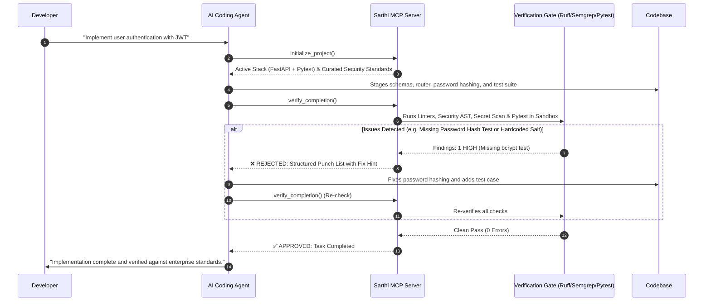

<div align="center">

# 🛡️ Sarthi

### The Autonomous Senior Tech Lead & Quality Gate for AI Coding Agents

[](https://github.com/Mayurkhalse/ForgeCore/actions/workflows/ci.yml)
[](https://www.python.org/)
[](https://opensource.org/licenses/MIT)
[](https://github.com/astral-sh/ruff)
[](https://modelcontextprotocol.io/)
[](https://github.com/Mayurkhalse/ForgeCore)

<p align="center">
  <b>Connect once. Your AI agent plans, writes, and verifies code against real enterprise standards—from the very first line.</b>
</p>

[Quickstart](#-quickstart-in-60-seconds) • [Why Sarthi?](#-why-sarthi) • [Key Features](#-core-superpowers) • [How It Works](#-how-it-works) • [Documentation](#-documentation)

---

</div>

## 💡 What is Sarthi?

When you ask an AI coding agent (like **Google Antigravity**, **Cursor**, or **Claude Code**) to build an application, it writes hundreds of lines of code in seconds. But by default, AI agents write demo-quality code:
- They cram business logic, database queries, and routes into **messy, monolithic files**.
- They leave **plain-text credentials, unparameterized database queries, and unmasked PII**.
- They write superficial tests (like `assert True`) or **skip testing entirely**.
- Worst of all, they declare **"Task Complete!"** even when the code is broken or insecure.

**Sarthi is the automated Senior Technical Lead and Quality Inspector sitting right beside your AI.**

Operating locally as a native **Model Context Protocol (MCP)** server, Sarthi intercepts the AI's workflow:
1. **Detects** your project's technology stack and conventions.
2. **Injects** stack-specific enterprise engineering standards directly into the AI's context.
3. **Confines** all execution inside a secure OS-level sandbox to protect your developer machine.
4. **Verifies** generated code with deterministic linters, security AST scanners, and test runners.
5. **Blocks** the AI from marking tasks "Done" until every quality and security check passes 100%.

---

## ⚡ Quickstart in 60 Seconds

### 1. Install Sarthi

```bash
# Using uv (recommended)
uv tool install sarthi

# Or using pip
pip install sarthi
```

### 2. Connect to Google Antigravity (or any MCP Client)

```bash
# 1-Click integration for Google Antigravity
sarthi install antigravity
```
*Sarthi automatically configures the MCP server in your IDE and injects the Core Governance Contract.*

### 3. Start Coding in Antigravity (Zero Manual Setup!)

That's it! Simply open any project in Google Antigravity and prompt your AI coding agent as usual. 

Sarthi's injected **Core Governance Contract** instructs the AI agent to automatically call `sarthi.initialize_project` at the start of your session. Sarthi will:
- 🔍 **Auto-detect your tech stack** (FastAPI, React, Spring Boot, etc.).
- 📚 **Inject relevant standards and ECC skills** directly into the agent.
- 🛑 **Intercept completions** and run `verify_project` before any task is marked done.

> [!TIP]
> **Optional: Manual Project Initialization (`sarthi init`)**
> You do **not** need to run `sarthi init` for Antigravity to work—the AI handles it automatically! Run `sarthi init` from your terminal only if you want to pre-scaffold `.sarthi/project.yaml` to customize rules, set custom test commands, or inspect the detected stack (`sarthi context`) from your CLI ahead of time.

---

## 🎯 Why Sarthi?

| Concern | Without Sarthi (Standard AI Agent) | With Sarthi (Governed AI Agent) |
| :--- | :--- | :--- |
| **Code Structure** | Monolithic files (`app.py`) mixing DB queries, API routes, and business logic. | Strictly enforces layered architecture (routers, domain services, models, repositories). |
| **Database Safety** | Formats raw strings into SQL/Cypher queries, vulnerable to injection. | Semgrep AST rules mandate parameterized queries across all database drivers. |
| **Secrets & Keys** | Hardcodes API keys, database passwords, or JWT secrets directly into files. | Scans every file for credentials and enforces loading from environment variables. |
| **Testing Discipline** | Writes fake tests (`assert True`), mock-only tests, or skips testing entirely. | Discovers and executes actual test suites (`pytest`, `npm test`) inside an isolated sandbox. |
| **Developer Machine Safety**| AI scripts run with full user OS privileges; can read `~/.ssh` or delete personal files. | Sandboxed via Workspace Staging (fresh inodes) and OS kernel tokens (AppContainer / Bubblewrap). |
| **Git & Commit Hygiene** | Leaves a single massive commit with a vague message (`"finished app"`). | Enforces clean atomic Conventional Commits (`feat(...)`, `fix(...)`, `test(...)`). |
| **Definition of "Done"** | **Honor System:** The AI claims it is done as soon as generation stops. | **Evidence Gate:** The AI cannot complete until Sarthi's automated verification passes 100%. |

---

## 🚀 Core Superpowers

### 🔍 1. Dynamic Stack & Layer Detection
Sarthi instantly inspects your workspace and identifies active languages (Python, TypeScript, Go, Rust), frameworks (FastAPI, React, Django, Express), package managers (`uv`, `pnpm`), and test runners. It delivers only the exact rules needed for your stack, keeping context tokens lean and efficient.

### 📚 2. Curated Enterprise Standards (ECC Knowledge Base)
Pre-packaged with battle-tested standards spanning **6 core pillars**:
- **Architecture:** Layered separation, single responsibility, dependency inversion.
- **Security:** Injection prevention, PII data masking, credential hygiene.
- **Testing:** Unit test isolation, mandatory edge-case coverage, integration guidelines.
- **API Design:** RESTful conventions, Pydantic/DTO validation, standard error schemas.
- **Data Management:** Safe migration practices, transaction boundaries, connection pooling.
- **Performance:** Async non-blocking I/O, pagination enforcement, query indexing.

### 🛑 3. The Uncompromising "Completion Gate"
The AI cannot bypass quality checks. Sarthi runs deterministic verification tools:
- 🦀 **Ruff:** Ultra-fast Python linting, formatting, and typing validation.
- ⚡ **ESLint:** AST-based code health checks for JavaScript and TypeScript.
- 🛡️ **Semgrep:** Deep semantic vulnerability scanning (SQLi, SSRF, traversal, insecure deserialization).
- 🔑 **Secrets Scanner:** Entropy and pattern scanners preventing leaked API tokens or `.env` secrets.
- 🧪 **Test Runner:** Executes real test suites (`pytest`, `npm test`, `mvn`) within the sandbox.

### 📦 4. OS-Level Subprocess Sandbox & Workspace Staging
Protects your developer machine from buggy or malicious generated code:
- **Workspace Staging:** Automatically copies your repository by value into a fresh temporary workspace, allocating brand-new OS inodes to sever external hardlink sharing.
- **Symlink & Inode Defense:** Recursively validates symlinks (blocking escapes to `~/.ssh` or `/etc/passwd`) and rejects special files (FIFOs, sockets, device nodes) fail-closed.
- **Kernel-Level Confinement:** Multi-platform adapters for **Windows AppContainer** (default-deny ACLs & WFP network block), **Linux Bubblewrap** (minimal mount namespaces & `--unshare-net`), and **macOS Seatbelt**.

### 🔒 5. Tier 1 Sterile Git Execution
Prevents repository-based command injection:
- Strictly restricts metadata queries to an allowlist of 4 safe read-only operations.
- Neutralizes custom git hooks (`core.hooksPath=""`), filesystem monitors (`core.fsmonitor=false`), external diff drivers, and interactive pagers.
- Strips all `GIT_*` and network proxy environment variables before execution.

### 🔄 6. Self-Healing Remediation Loop
When verification detects an issue, Sarthi doesn't just fail; it emits a structured punch list with exact file paths, line numbers, and actionable **Fix Hints**. The AI reads the feedback, refactors the code, and re-submits until Sarthi certifies a clean `PASS`.

### 🌐 7. 100% Offline & Private
Sarthi runs entirely on your local machine over standard I/O (`stdio`). Zero cloud dependencies, zero external telemetry, zero API keys required. Safe for proprietary, enterprise, and air-gapped codebases.

---

## 🔄 How It Works



---

## ⚙️ Configuration (`.sarthi/project.yaml`)

Customize Sarthi's rules, strictness, and commands on a per-project basis:

```yaml
version: 1
project:
  name: "my-production-service"

# Active layers detected or customized
layers:
  add:
    - python
    - fastapi
    - postgresql
    - pytest

# Generation requirements enforced on the AI agent
generation:
  require_plan: true         # Mandates architectural plan before writing code
  require_tests: true        # Forbids completing tasks without automated tests

# Quality & Verification thresholds
verify:
  fail_on: high              # Blocks completion on HIGH or CRITICAL findings
  commands:
    test: "pytest -v"        # Explicit verified test command
```

---

## 📖 Documentation

* 📘 [**FEATURES.md**](FEATURES.md) — Comprehensive feature guide, non-technical explanations, and deep-dive comparisons.
* 🏛️ [**ARCHITECTURE.md**](ARCHITECTURE.md) — Full technical design, low-level architecture, and protocol contracts.
* 🛡️ [**SEC-01C Architecture**](docs/security/SEC-01C-ARCHITECTURE.md) — Kernel-level subprocess sandbox design across Windows, Linux, and macOS.
* 🔄 [**WORKFLOW.md**](WORKFLOW.md) — Operational development guidelines and quality protocols.

---

## 💻 CLI Command Reference

| Command | Description |
| :--- | :--- |
| `sarthi install antigravity` | Configures Sarthi MCP server in Google Antigravity with 1 click. |
| `sarthi uninstall antigravity` | Cleanly uninstalls Sarthi and restores IDE backups byte-for-byte. |
| `sarthi init` | (Optional) Manually scaffolds `.sarthi/project.yaml` and detects codebase layers. |
| `sarthi verify` | Manually triggers the verification pipeline against changed files. |
| `sarthi approve [path]` | Reviews and approves command templates for execution trust. |
| `sarthi lint-standards` | Validates custom and ECC standards against schema definitions. |

---

## 🤝 Contributing & Community

Sarthi is an open-source, local-first engineering governance platform. Contributions, standards contributions, and platform adapters are warmly welcomed!

1. Fork the repository.
2. Create your feature branch (`git checkout -b feat/amazing-feature`).
3. Commit your changes using Conventional Commits (`git commit -m 'feat: add amazing feature'`).
4. Ensure all linters and tests pass (`uv run ruff check .` and `uv run pytest`).
5. Open a Pull Request.

---

## 📄 License

Distributed under the **MIT License**. See `LICENSE` for more information.

<div align="center">
  <sub>Built with precision for the future of agentic software engineering.</sub>
</div>

