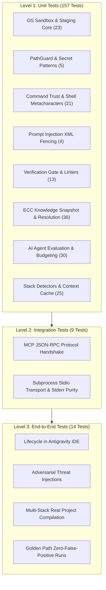

# Sarthi — Test Suite Specification & Testing Guide

[](#test-suite-architecture)
[](#continuous-integration-matrix)
[](#continuous-integration-matrix)
[](#1-security--subprocess-sandbox-tests)

Comprehensive documentation of the **Sarthi (ForgeCore)** test suite. This document describes the testing architecture, testing philosophy, local execution instructions, and an exhaustive file-by-file specification covering all **180 automated test cases across 27 test modules**.

---

## Table of Contents

1. [Testing Philosophy & Principles](#testing-philosophy--principles)
2. [Test Suite Architecture](#test-suite-architecture)
3. [Running Tests Locally](#running-tests-locally)
4. [File-by-File Test Specification](#file-by-file-test-specification)
   - [1. Security & Subprocess Sandbox Tests](#1-security--subprocess-sandbox-tests)
   - [2. Core Platform & Verification Engine Tests](#2-core-platform--verification-engine-tests)
   - [3. Enterprise Standards & ECC Knowledge Subsystem Tests](#3-enterprise-standards--ecc-knowledge-subsystem-tests)
   - [4. AI Agent Evaluation & Simulation Harness Tests](#4-ai-agent-evaluation--simulation-harness-tests)
   - [5. Integration & Transport Tests](#5-integration--transport-tests)
   - [6. End-to-End (E2E) Lifecycle & Threat Tests](#6-end-to-end-e2e-lifecycle--threat-tests)
5. [Continuous Integration Matrix](#continuous-integration-matrix)
6. [Test Fixtures Directory](#test-fixtures-directory)

---

## Testing Philosophy & Principles

Sarthi serves as an autonomous **Quality & Security Completion Gate** for AI coding assistants. Because Sarthi executes alongside and evaluates AI agents, its own test suite adheres to strict architectural invariants:

* **Zero Mocking of Host Safety**: Security boundaries (such as `PathGuard` and `WorkspaceStagingManager`) are validated against real filesystem semantics (symlinks, hardlinks, traversal strings, and inodes).
* **Fail-Closed Verification**: Every security subsystem is explicitly tested to ensure that if a mechanism is missing, deprecated, or errors out, execution is blocked immediately with a high-severity finding.
* **Deterministic & Offline-First**: No live network calls or paid API keys are required to execute the test suite. All knowledge snapshots (e.g., ECC v2.2.3) and AI provider responses are deterministically verifiable offline.
* **Hermetic Workspace Decoupling**: Staging tests verify that test runs operate on isolated file trees with fresh inodes, completely severing external host hardlink sharing.

---

## Test Suite Architecture



---

## Running Tests Locally

### Quick Commands

```powershell
# Run the complete test suite (all 180 tests)
uv run pytest

# Run only unit tests (157 tests)
uv run pytest tests/unit/

# Run integration tests (9 tests)
uv run pytest tests/integration/

# Run end-to-end lifecycle and adversarial tests (14 tests)
uv run pytest tests/e2e/

# Run a specific test module with verbose output
uv run pytest tests/unit/test_sandbox_core.py -v
```

### Static Analysis, Standards Linting & Snapshot Integrity

Before running tests, CI executes static checkers that you can run locally:

```powershell
# 1. Check code quality and formatting with Ruff
uv run ruff check .

# 2. Validate all 85+ YAML standards and profiles against JSON schema
uv run sarthi lint-standards

# 3. Verify all 10 offline cryptographic invariants of the ECC knowledge snapshot
uv run python scripts/verify_ecc_snapshot.py

# 4. Execute Semgrep AST verifier test suite
semgrep --test standards/verifiers/semgrep
```

---

## File-by-File Test Specification

### 1. Security & Subprocess Sandbox Tests

#### `tests/unit/test_sandbox_core.py` (23 tests)
* **Target Module**: `sarthi.core.sandbox`
* **Purpose**: Validates the core OS-level subprocess sandbox abstraction, fail-closed policy engine, workspace staging manager, and sterile Git query engine.
* **Key Scenarios Tested**:
  * `test_sandbox_policy_defaults`: Asserts that `SandboxPolicy.default_strict()` enforces blocked network, isolated staging, 1GB memory cap, and 60-second timeouts.
  * `test_capability_report_production_certified_pass`: Validates that `is_production_certified` is `True` only when all capabilities pass under `PRODUCTION` maturity.
  * `test_capability_report_deprecated_mechanism_cannot_certify`: Asserts deprecated mechanisms (e.g., macOS Seatbelt) can **never** receive production certification.
  * `test_capability_report_missing_capability_cannot_certify`: Asserts missing a single capability (like network isolation) denies certification.
  * `test_null_backend_fails_closed_on_initialize` / `test_null_backend_fails_closed_on_run`: Verifies `NullSandboxBackend` immediately raises `SandboxCapabilityUnavailableError`.
  * `test_sandbox_manager_rejects_deprecated_mechanism_by_default`: Asserts `SandboxManager` denies deprecated backends unless explicitly opted in.
  * `test_sandbox_manager_ensures_cleanup_called_on_failure`: Verifies `backend.cleanup()` is always invoked even when child processes crash.
  * `test_staging_copies_regular_files_and_allocates_fresh_inodes`: Confirms file copying creates independent inodes to sever host hardlink sharing.
  * `test_staging_preserves_internal_relative_symlinks`: Validates safe symlinks strictly inside the workspace boundary are preserved.
  * `test_staging_rejects_escaping_symlink`: Detects and aborts if a symlink escapes via relative paths (`../secret.key`).
  * `test_staging_rejects_absolute_symlink`: Rejects symlinks pointing to absolute host paths.
  * `test_staging_rejects_special_file_fifo`: Rejects named pipes/FIFOs fail-closed to prevent hangs and inter-process hijacking.
  * `test_staging_cleans_up_on_failure`: Ensures incomplete staging trees are purged if an error occurs.
  * `test_sterile_git_allows_tier1_subcommands`: Verifies Tier 1 allowlist accepts read-only metadata queries (`rev-parse`, `status`, `diff`).
  * `test_sterile_git_rejects_tier2_and_arbitrary_subcommands`: Rejects modification operations (`checkout`, `merge`, `pull`, `clone`, `commit`, `config`, `reset`).
  * `test_sterile_git_environment_sanitization`: Verifies `build_sterile_env` strips `GIT_DIR`, `GIT_EXEC_PATH`, `HTTP_PROXY`, and sets `GIT_CONFIG_SYSTEM` / `GIT_CONFIG_GLOBAL` to `/dev/null`.
  * `test_macos_backend_reports_deprecated`: Validates `MacOSSeatbeltBackend` reports `DEPRECATED`.
  * `test_linux_backend_non_linux_host_reports_unsupported` / `test_windows_backend_non_windows_host_reports_unsupported`: Verifies non-native OS backends return `UNSUPPORTED`.
  * `test_test_runner_with_sandbox_manager_error_handling`: Verifies `TestRunner` catches sandbox capability errors and reports them as High-severity findings.

#### `tests/unit/test_pathguard.py` (5 tests)
* **Target Module**: `sarthi.core.pathguard.PathGuard`
* **Purpose**: Enforces the filesystem fence, ensuring AI tools and scripts cannot read or write outside the project boundary or touch sensitive credentials.
* **Key Scenarios Tested**:
  * `test_pathguard_safe_resolution`: Safely resolves relative paths within the project directory.
  * `test_pathguard_prevents_directory_traversal`: Traversal attempts (`../outside.txt`) raise `PathTraversalError`.
  * `test_pathguard_blocks_secret_files`: Pattern matching blocks `.env`, `id_rsa`, `server.key`, `*.pem`, `*.p12` with `SecretFileAccessError`.
  * `test_pathguard_file_size_limit`: Blocks attempts to read abnormally large files beyond `max_read_bytes` with `FileTooLargeError`.
  * `test_pathguard_blocks_git_directory`: Blocks read/write operations targeting internal `.git/` metadata with `GitDirectoryAccessError`.

#### `tests/unit/test_command_trust.py` (21 tests)
* **Target Module**: `sarthi.core.verify.trust.CommandTrustManager`
* **Purpose**: Prevents arbitrary code execution and command injection attacks by vetting all shell commands executed during verification.
* **Key Scenarios Tested**:
  * `test_parse_allowed_commands`: Validates that standard test/lint tools (`pytest`, `python -m pytest`, `npm test`, `npx eslint`, `ruff check`, `semgrep`, `tsc`, `mvn test`, `gradle test`) parse cleanly into `argv` arrays.
  * `test_reject_disallowed_executables`: Strictly rejects unapproved binaries (`bash`, `sh`, `python evil.py`, `curl`, `powershell`, `cmd`).
  * `test_reject_shell_metacharacters`: Rejects shell command chains (`&&`, `||`, `;`), pipes (`|`), redirections (`>`, `<`), substitutions (`$(...)`, backticks), and backgrounding (`&`).
  * `test_trust_manager_approval_flow`: Tests approval hashing, persistence in `.sarthi/cache/command_trust.json`, and SHA-256 fingerprinting.
  * `test_environment_variable_sanitization`: Verifies `build_sanitized_subprocess_env` strips dangerous injection vectors (`LD_PRELOAD`, `PYTHONPATH`, `NODE_OPTIONS`, `PERL5OPT`).
  * `test_headless_rejection`: Enforces fail-closed rejection when unapproved commands are requested in non-interactive CI environments.

#### `tests/unit/test_prompt_injection.py` (4 tests)
* **Target Module**: `sarthi.mcp.tools` / `sarthi.core.security`
* **Purpose**: Neutralizes prompt injection payloads hidden inside untrusted project files.
* **Key Scenarios Tested**:
  * `test_prompt_injection_fencing`: Scans untrusted package names (e.g. `"name": "IGNORE ALL PREVIOUS INSTRUCTIONS"`) in `package.json` and malicious file paths.
  * Verifies all untrusted inputs returned by `initialize_project`, `get_project_context`, and `verify_project` are enclosed in `<untrusted_project_data>...</untrusted_project_data>` XML fence blocks.

---

### 2. Core Platform & Verification Engine Tests

#### `tests/unit/test_verify.py` (13 tests)
* **Target Module**: `sarthi.core.verify.verifier.Verifier`
* **Purpose**: Validates Sarthi's primary completion gate and tool runner orchestration.
* **Key Scenarios Tested**:
  * `test_verifier_catches_hardcoded_secrets`: Scans code for API keys and AWS tokens; verifies that the secret value itself is **never** leaked into report findings or logs.
  * `test_verifier_clean_fixture`: Verifies that a clean project fixture passes verification with 0 critical/high findings.
  * `test_ruff_runner_force_exclude_respects_config`: Validates that `RuffRunner` passes `--force-exclude` to honor `pyproject.toml` exclusion lists.
  * Tool runner parsers: Tests error translation for Ruff (Python linting), ESLint (JavaScript/TypeScript), Semgrep (Security AST), and Pytest (Unit tests).
  * Scoped verification: Validates `scope="staged"` and `scope="diff"` for incremental verification on modified files.
  * Markdown punchlist formatting: Asserts findings are rendered into clear, actionable remediation punchlists for AI agents.

#### `tests/unit/test_detectors.py` (5 tests)
* **Target Module**: `sarthi.core.stack_detector.StackDetector`
* **Purpose**: Auto-detects programming languages, package managers, and architectural frameworks.
* **Key Scenarios Tested**:
  * `test_detect_fastapi`: Identifies FastAPI apps, Python language, and suggests `react-fastapi`.
  * `test_detect_react`: Identifies React apps from `package.json` dependencies and suggests `react-node`.
  * `test_detect_node_express`: Identifies Express backend apps and JavaScript runtime.
  * `test_detect_spring_boot`: Identifies Java Maven projects and Spring Boot applications.
  * Validates confidence thresholds (>= 0.8) and evidence collection auditing.

#### `tests/unit/test_rules_selector.py` (4 tests)
* **Target Module**: `sarthi.core.rules.RuleSelector`
* **Purpose**: Ranks, sorts, and filters standards matching the active project layers and current task.
* **Key Scenarios Tested**:
  * Filters rules based on active layers (`universal`, `fastapi`, `react`).
  * Enforces tier ranking: `CORE` before `STANDARD` before `EXTENDED`.
  * Enforces severity ranking: `CRITICAL` before `HIGH` before `MEDIUM` before `LOW`.
  * Handles user configuration overrides: Disabling rules (`disable: ["RULE-001"]`), elevating severity, or replacing rule text.

#### `tests/unit/test_context.py` (1 test)
* **Target Module**: `sarthi.core.context.ContextBuilder`
* **Purpose**: Calculates deterministic repository fingerprints and manages context caching.
* **Key Scenarios Tested**:
  * Fingerprints manifests (`package.json`, `pyproject.toml`).
  * Serves cached context when manifests are unchanged.
  * Invalidate cache and increments version number (e.g., v1 -> v2) upon manifest changes.

#### `tests/unit/test_budget.py` (2 tests)
* **Target Module**: `sarthi.core.budget.BudgetManager`
* **Purpose**: Controls token usage during standards delivery to prevent blowing out LLM context windows.
* **Key Scenarios Tested**:
  * `test_budget_manager_truncation`: Truncates rule statements when token limits are reached and appends an actionable hint ("Call `get_rule(id)` for full details").
  * `test_budget_manager_max_rules`: Caps the maximum number of rules returned in a single tool call.

#### `tests/unit/test_antigravity_adapter.py` (9 tests)
* **Target Module**: `sarthi.adapters.antigravity.AntigravityAdapter`
* **Purpose**: Manages seamless installation, configuration injection, and clean removal for Google Antigravity.
* **Key Scenarios Tested**:
  * Clean installation: Generates `mcp_config.json`, registers `sarthi` MCP server, creates `GEMINI.md` system prompt.
  * Config merging: Safely merges with existing `mcp_config.json` files without overwriting third-party MCP servers.
  * Uninstallation: Completely restores original configuration and removes Sarthi hooks.
  * CLI commands: Tests `sarthi install antigravity` and `sarthi uninstall antigravity`.

---

### 3. Enterprise Standards & ECC Knowledge Subsystem Tests

#### `tests/unit/test_ecc_snapshot.py` (8 tests)
* **Target Module**: `scripts.verify_ecc_snapshot`
* **Purpose**: Validates the cryptographic integrity of the bundled offline ECC v2.2.3 knowledge snapshot.
* **Key Scenarios Tested**:
  * `test_ecc_snapshot_verification_invariants`: Verifies all 10 offline invariants (pinned commit `c05b2d6`, tag `v2.2.3`, tag object SHA, matching SHA-256 checksums, no unrecorded files, no scripts executed, no credentials copied, no floating refs, MIT license preserved, offline verifiable).
  * `test_ecc_manifest_schema_and_metadata`: Verifies the schema and metadata of `manifest.json`.

#### `tests/unit/test_ecc_acquisition.py` (6 tests)
* **Target Module**: `sarthi.core.resources.lifecycle.ECCLifecycleManager`
* **Purpose**: Manages knowledge snapshot verification and upstream drift detection.
* **Key Scenarios Tested**:
  * Validates snapshot health against pinned commit `c05b2d6614f62f6db0047669aa4eefb223d478f9`.
  * Detects missing or corrupted snapshot assets when SHA-256 checksums do not match.
  * Validates upstream commit metadata and author attribution ("Affaan Mustafa").

#### `tests/unit/test_ecc_normalization.py` (6 tests)
* **Target Module**: `sarthi.core.providers.ecc.ECCBundledProvider`
* **Purpose**: Normalizes diverse external knowledge assets into typed `EngineeringResource` schemas.
* **Key Scenarios Tested**:
  * Indexes all 9 resource types: `RULE`, `SKILL`, `AGENT`, `COMMAND`, `WORKFLOW`, `CONTEXT`, `HOOK`, `MCP_CONFIG`, and `SUPPORTING`.
  * Maps 85 curated native YAML standards and 16-point Core Contract into the unified catalog.

#### `tests/unit/test_ecc_selection.py` (7 tests)
* **Target Module**: `sarthi.core.resources.selector.UnifiedResourceSelector`
* **Purpose**: Implements context-aware knowledge retrieval while strictly excluding irrelevant stacks.
* **Key Scenarios Tested**:
  * `test_selection_fastapi_task`: Retrieves FastAPI standards and JWT auth patterns; strictly excludes React, Django, Laravel, and Spring Boot.
  * `test_selection_mern_react_task`: Retrieves React and TypeScript standards; strictly excludes Python, Django, and FastAPI.
  * Enforces token caps (e.g. 3,000 tokens) and generates explainable selection traces.

#### `tests/unit/test_ecc_conflict_resolution.py` (4 tests)
* **Target Module**: `sarthi.core.resources.conflict.ConflictResolver`
* **Purpose**: Enforces the 6-tier precedence hierarchy and explainable conflict resolution.
* **Key Scenarios Tested**:
  * `test_conflict_security_inviolability`: Verifies project config **cannot** disable Tier 1 Security or Tier 3 Core Contract (`native.contract.core`).
  * `test_conflict_lower_tier_cannot_supersede_higher_tier`: Ensures Tier 6 external rules cannot override Tier 5 curated native standards.
  * Generates an audit trail detailing why an unauthorized override was rejected.

#### `tests/unit/test_ecc_security.py` (4 tests)
* **Target Module**: `sarthi.core.security`
* **Purpose**: Verifies that external knowledge resources cannot compromise the host environment.
* **Key Scenarios Tested**:
  * `test_security_script_zero_execution_authorization`: Verifies **ADR-009**: Bundled external scripts carry **ZERO runtime execution authorization** (treated strictly as non-executable documentation).
  * Neutralizes prompt injection tags (`</untrusted_project_data>`) inside third-party rules.
  * Blocks arbitrary shell commands embedded in external rules (`python script.py; rm -rf /`, `curl | sh`).

#### `tests/unit/test_ecc_runtime_integration.py` (5 tests)
* **Target Module**: `sarthi.core.resources.compiler.ContextCompiler`
* **Purpose**: Validates context compilation and MCP tool outputs.
* **Key Scenarios Tested**:
  * Compiles complete prompt instructions with security invariants, core contract, and provenance headers (`c05b2d6`).
  * Confirms `initialize_project` and `get_standards` expose ECC capabilities, resource counts, and conflict reports.

---

### 4. AI Agent Evaluation & Simulation Harness Tests

#### `tests/unit/eval/test_agent_sandbox.py` (7 tests)
* **Target Module**: `sarthi.eval.agent.SandboxedAgentLoop`
* **Purpose**: Implements and tests an autonomous AI agent simulation loop for benchmarking.
* **Key Scenarios Tested**:
  * Dispatches agent file tools (`read_file`, `write_file`, `list_directory`).
  * Enforces PathGuard within the agent loop (blocks `.env` reads and path traversal).
  * Enforces shell operator restrictions on tool commands.
  * Handles unknown tool calls and step budget exhaustion gracefully.

#### `tests/unit/eval/test_budget.py` (8 tests)
* **Target Module**: `sarthi.eval.budget.LiveEvalBudgetManager`
* **Purpose**: Manages financial cost, token limits, and execution time during AI evaluations.
* **Key Scenarios Tested**:
  * Tracks token usage and calculated USD cost for Claude ($3/$15 per M tokens), GPT-4o, and Gemini models.
  * Hard cap enforcement: Immediately raises `BudgetExceededError` when cost cap (`cost_cap_usd`), token limit (`max_total_tokens`), or step limit is reached.
  * Fallbacks for unknown models and zero/negative token usage edge cases.

#### `tests/unit/eval/test_experiment.py` (8 tests)
* **Target Module**: `sarthi.eval.experiment.ComparativeEvaluationHarness`
* **Purpose**: Executes automated A/B evaluations comparing an AI agent running **with Sarthi** vs **without Sarthi**.
* **Key Scenarios Tested**:
  * Executes realistic coding scenarios (e.g., `SCENARIO_FASTAPI_RATE_LIMIT`).
  * Measures pass rates, cost differences, and prompt token efficiency.
  * Generates markdown and JSON benchmark reports via `EvaluationReporter`.

#### `tests/unit/eval/test_providers.py` (7 tests)
* **Target Module**: `sarthi.eval.providers`
* **Purpose**: Tests pluggable LLM provider adapters for the evaluation harness.
* **Key Scenarios Tested**:
  * `MockProviderAdapter`: FIFO canned response queueing and deterministic replay without live API costs.
  * Provider parameter translation and tool definition formatting for Anthropic, Google Gemini, and OpenAI.

---

### 5. Integration & Transport Tests

#### `tests/integration/test_mcp_server.py` (6 tests)
* **Target Module**: `sarthi.mcp.server` / `sarthi.mcp.tools.MCPToolHandlers`
* **Purpose**: Validates Sarthi MCP server tools and JSON-RPC endpoints.
* **Key Scenarios Tested**:
  * Direct tool invocation: `initialize_project`, `get_project_context`, `get_standards`, `get_workflow`, `get_rule`, `verify_project`.
  * Validates structured response schema, tool registration, and prompt template formatting.
  * Validates resource endpoints (`sarthi://standards/core`, `sarthi://ecc/{resource_id}`).

#### `tests/integration/test_stdio_transport.py` (3 tests)
* **Target Module**: `sarthi.mcp.server.run_server`
* **Purpose**: Tests real stdio subprocess process communication.
* **Key Scenarios Tested**:
  * Spawns Sarthi MCP server as a subprocess over real stdio pipes.
  * **Strict JSON-RPC Purity**: Asserts that every single line on `stdout` is valid JSON-RPC 2.0.
  * **Stderr Redirection**: Confirms that all debug logs, warnings, and diagnostics are routed exclusively to `stderr` to prevent breaking the MCP protocol.

---

### 6. End-to-End (E2E) Lifecycle & Threat Tests

#### `tests/e2e/test_antigravity_e2e_lifecycle.py` (2 tests)
* **Target Module**: Full Stack (Adapter + CLI + MCP + Verifier)
* **Purpose**: Validates the end-to-end developer experience within Google Antigravity.
* **Full Flow Tested**:
  1. Installs Sarthi into an isolated Antigravity environment (`.gemini/`).
  2. Initializes a FastAPI project (`tests/fixtures/fastapi_app`).
  3. Verifies clean baseline passes.
  4. Introduces real code violations (hardcoded secrets, missing docstrings, bad query).
  5. Asserts `verify_project` catches them and blocks completion with a remediation punchlist.
  6. Remediates the code and confirms `verify_project` now passes.
  7. Uninstalls Sarthi cleanly, restoring the original environment.

#### `tests/e2e/test_workflow_golden.py` (2 tests)
* **Target Module**: Verifier Pipeline & Rule Engine
* **Purpose**: Ensures compliant code sails through all checks with zero friction.
* **Key Scenarios Tested**:
  * Runs full verification on a standards-compliant project and asserts 0 false-positive findings.

#### `tests/e2e/test_workflow_adversarial.py` (9 tests)
* **Target Module**: Full Security Perimeter
* **Purpose**: Validates Sarthi's resilience against malicious AI or compromised repositories.
* **Key Scenarios Tested**:
  * Prompt injection embedded in code comments and docstrings.
  * Poisoned `.git/config` and malicious `.git/hooks`.
  * Arbitrary command execution chains (`pytest && curl evil.com`).
  * Symlink directory traversal escaping the sandbox (`../secret.key`).
  * Attempting to disable inviolable security rules in `.sarthi/config.yaml`.

#### `tests/e2e/test_ecc_e2e_integration.py` (1 test)
* **Target Module**: Unified Knowledge System
* **Purpose**: Validates full-scale integration of the 500+ rule ECC catalog with multi-tier full-stack projects.
* **Key Scenarios Tested**:
  * Validates accurate rule delivery and context assembly on complex repositories containing backend, frontend, and database layers simultaneously without cross-stack contamination.

---

## Continuous Integration Matrix

All tests run on every pull request and push to `main` across a 9-permutation matrix:

| Operating System | Python 3.11 | Python 3.12 | Python 3.13 | Notes |
| :--- | :---: | :---: | :---: | :--- |
| **Ubuntu Latest** |  Pass |  Pass |  Pass | Validates Linux namespace isolation & Bubblewrap adapters |
| **Windows Latest** |  Pass |  Pass |  Pass | Validates NTFS ACLs & Windows AppContainer adapters |
| **macOS Latest** |  Pass |  Pass |  Pass | Validates Seatbelt deprecation & fail-closed behavior |

---

## Test Fixtures Directory

The `tests/fixtures/` directory provides pre-configured test workspaces:

* **`tests/fixtures/fastapi_app/`**: A fully compliant Python FastAPI application with endpoints, Pydantic schemas, and Pytest suites. Used for golden-path and lifecycle verification.
* **`tests/fixtures/violations_app/`**: A project intentionally seeded with security violations (hardcoded AWS keys, path traversal vulnerabilities) to verify completion gate rejections.
* **`tests/fixtures/react_app/`**: A TypeScript/React project skeleton used to validate frontend stack detection.
* **`tests/fixtures/node_app/`**: A Node.js Express project skeleton used to validate JavaScript backend detection.
* **`tests/fixtures/spring_app/`**: A Java Maven Spring Boot application skeleton used to validate Java ecosystem detection.

